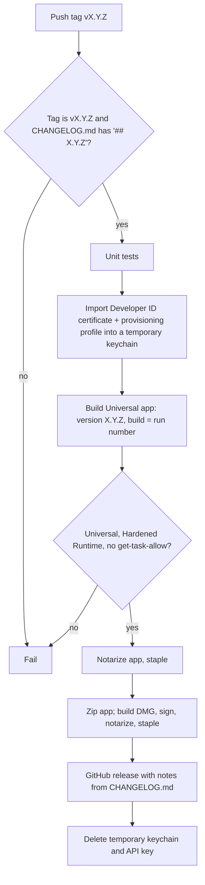

# Releasing Slate

Two GitHub Actions workflows (`macos-26` runners):

- **CI** (`.github/workflows/ci.yml`): every push and pull request to `master`. Ad-hoc signed Universal Release build and unit tests.
- **Release** (`.github/workflows/release.yml`): pushing a `vX.Y.Z` tag. Developer ID signed, notarized Universal app published to GitHub Releases as `Slate-X.Y.Z.zip` and `Slate-X.Y.Z.dmg`.

## Cutting a release

1. In `CHANGELOG.md`, rename `## Unreleased` to `## X.Y.Z` and commit to `master`.
2. Tag and push:

       git tag vX.Y.Z
       git push origin master vX.Y.Z

The release fails without a `## X.Y.Z` section in `CHANGELOG.md`.

## One-time setup

### Apple Developer account

1. **Developer ID Application certificate** (only the Account Holder can create it): Xcode > Settings > Accounts > Manage Certificates > + > Developer ID Application. Export it with its private key from Keychain Access as a password-protected `.p12`.
2. **App ID**: [Identifiers](https://developer.apple.com/account/resources/identifiers/list) > + > App IDs > App, platform macOS, explicit Bundle ID `io.opus1.slate`.
3. **Provisioning profile**: [Profiles](https://developer.apple.com/account/resources/profiles/list) > + > Distribution > Developer ID, App ID `io.opus1.slate`, the Developer ID certificate above. Download the `.provisionprofile`. It must allow `keychain-access-groups` (config approvals are stored in the data protection keychain); the workflow checks this.
4. **Notary API key**: [App Store Connect > Users and Access > Integrations > Team Keys](https://appstoreconnect.apple.com/access/integrations/api) > +, access Developer. Download the `.p8` (only once) and note the Key ID and Issuer ID.

### GitHub repository secrets

`gh secret set` without a value prompts for it.

| Secret | Value |
|---|---|
| `DEVELOPER_ID_CERT_P12_BASE64` | `base64 -i DeveloperID.p12 \| gh secret set DEVELOPER_ID_CERT_P12_BASE64` |
| `DEVELOPER_ID_CERT_PASSWORD` | `.p12` export password |
| `DEVELOPER_ID_PROFILE_BASE64` | `base64 -i Slate.provisionprofile \| gh secret set DEVELOPER_ID_PROFILE_BASE64` |
| `NOTARY_API_KEY_P8_BASE64` | `base64 -i AuthKey_<KEYID>.p8 \| gh secret set NOTARY_API_KEY_P8_BASE64` |
| `NOTARY_API_KEY_ID` | Key ID |
| `NOTARY_API_ISSUER_ID` | Issuer ID |

Delete the local `.p12` and `.p8` files once the secrets are set.
